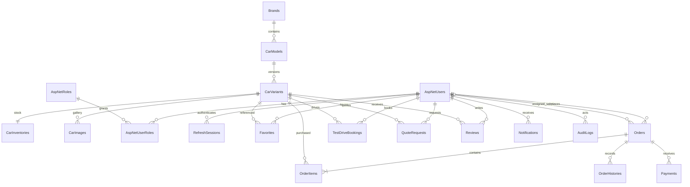

# Thiết kế AutoCarDB

Nguồn schema duy nhất: `AutoCar.Api/Data/AppDbContext.cs` và `AutoCar.Api/Migrations`. Script SQL được sinh từ migrations, có `__EFMigrationsHistory`, không phải schema độc lập.

## Bảng và ràng buộc

| Bảng | PK | FK / vai trò |
|---|---|---|
| Brands | Id int | Name unique, IsActive |
| CarModels | Id int | BrandId → Brands; unique (BrandId, Name) |
| CarVariants | Id int | CarModelId → CarModels; Code unique; Price ≥0; RowVersion |
| CarImages | Id int | CarVariantId; Url, SortOrder |
| CarInventories | Id int | CarVariantId unique; Stock ≥0, Sold ≥0; RowVersion |
| AspNetUsers | Id string | IdentityUser; email/normalized username unique |
| AspNetRoles | Id string | IdentityRole; normalized name unique |
| AspNetUserRoles | (UserId, RoleId) | FK users và roles |
| RefreshSessions | Id int | UserId; SHA-256 TokenHash unique; ExpiresAt, Revoked, RowVersion |
| Favorites | Id int | UserId, CarVariantId; unique theo cặp |
| Orders | Id int | UserId, AssignedSalesId; Total, Status, PaymentStatus, RowVersion |
| OrderItems | Id int | OrderId, CarVariantId; Quantity >0; UnitPrice snapshot |
| OrderHistories | Id int | OrderId, ActorId; trạng thái, ghi chú, thời điểm |
| TestDriveBookings | Id int | UserId, CarVariantId, AssignedSalesId |
| QuoteRequests | Id int | UserId, CarVariantId, AssignedSalesId |
| Payments | Id int | OrderId, ConfirmedById; Amount >0; Reference unique |
| Reviews | Id int | UserId, CarVariantId unique; Rating 1–5 |
| Promotions | Id int | Nội dung, khoảng hiệu lực |
| Contacts | Id int | Yêu cầu công khai; không cần tài khoản |
| Notifications | Id int | UserId; IsRead |
| AuditLogs | Id int | ActorId; hành động, tài nguyên, thời điểm |

Identity stores hiện thực các interface của ASP.NET Core Identity bằng EF. Không triển khai external login, claims tùy biến, 2FA hay email token provider; vì vậy không tạo các bảng Identity phụ chưa sử dụng. Mật khẩu do Identity `PasswordHasher` quản lý, không lưu plaintext.

Mọi quan hệ dùng `Restrict`. Không xóa dữ liệu đơn hàng khi xóa/ẩn xe. Hãng đã có dòng xe được vô hiệu hóa; xe được ẩn. Số tiền dùng `decimal(18,2)`. Thời điểm dùng `DateTimeOffset` UTC, hiển thị giờ Việt Nam theo client; báo cáo tháng chuyển UTC+7. Index gồm giá/hiển thị, năm/kiểu dáng, trạng thái/ngày đơn, nhân viên/thời gian lịch hẹn và các unique keys.

## ERD

## Đồng thời và doanh thu

`OrderService.Change` dùng SQL transaction `Serializable`. Xác nhận đọc tồn, kiểm tra, trừ Stock và tăng Sold trong cùng transaction; đồng thời cập nhật Order.RowVersion, Inventory.RowVersion. Cạnh tranh cập nhật trả 409; deadlock SQL được xử lý là xung đột có thể thử lại. Không retry ngầm thao tác thanh toán.

Pending chưa giữ xe. Khách tự hủy khi Pending; Confirmed muốn hủy phải qua Admin/Sales được giao. Hủy Confirmed hoàn tồn kho đúng một lần; trạng thái terminal cấm xác nhận lại. Có thanh toán rồi hủy → RefundRequired, giữ lịch sử, cần cửa hàng xử lý hoàn tiền thủ công ngoài phạm vi tích hợp. Completed bắt buộc Paid và không có luồng hủy/hoàn doanh thu tự động. Revenue chỉ cộng Completed + Paid; giá UnitPrice không thay đổi khi sửa catalog.

Admin sửa xe cần gửi cả `rowVersion` và `inventoryVersion` nhận từ GET. Điều này ngăn form tồn kho cũ ghi đè số tồn vừa thay đổi bởi đơn hàng.

## Seed

15 hãng, 39 dòng, 78 phiên bản, nhiều phân khúc/nhiên liệu/hộp số và stock 0–5. Seed idempotent theo tên hãng, cặp hãng/dòng và mã phiên bản. Không tạo đơn hoặc doanh thu giả. Tài khoản chỉ seed khi cấu hình password Development. Giá và thông số là dữ liệu minh họa, SVG tự tạo không mô tả chính xác model thật.
