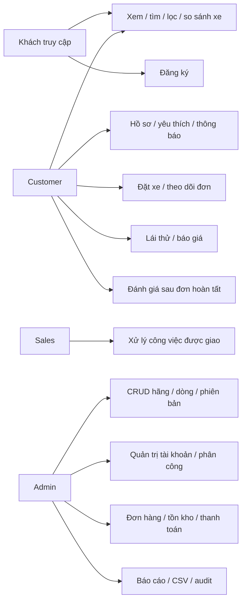
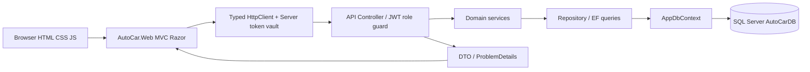

# Phân tích và kiến trúc AutoCar

Mục tiêu: showroom và quản lý giao dịch xe ở môi trường đồ án; website và API độc lập, SQL Server là nguồn dữ liệu duy nhất. Thiết kế bám trình tự tài liệu giảng viên: Entity → DbContext → IRepository → Repository → Controller → Program → Swagger. DTO, service nghiệp vụ, Identity và MVC được thêm bên ngoài lõi này.

## Tác nhân

| Tác nhân | Chức năng |
|---|---|
| Khách truy cập | Xem/tìm/lọc xe, chi tiết, so sánh, liên hệ, đăng ký |
| Customer | Hồ sơ, đổi mật khẩu, yêu thích, đặt xe/lái thử/tư vấn, lịch sử, thông báo, đánh giá sau mua |
| Sales | Chỉ xem/xử lý đơn, lịch hẹn và báo giá đã được phân công; thống kê công việc cá nhân |
| Admin | Danh mục, tồn kho, phân công, đơn, xác nhận chuyển khoản, tài khoản, dashboard, CSV, nhật ký |

## Đặc tả use case chính

### UC01 – CRUD xe

Admin đã đăng nhập → chọn dòng xe → nhập thông tin/ảnh/stock → MVC gateway gửi POST/PUT có CSRF → API kiểm role và DTO → CarService kiểm FK, ảnh upload và version → EF lưu SQL → API 201/204 → UI tải lại danh sách. Sửa form cũ trả 409; sai dữ liệu 400; ID thiếu 404. DELETE ẩn xe để bảo toàn giao dịch.

### UC02 – Đặt xe và xác nhận

Customer chọn xe/quantity → API kiểm xe hiển thị và stock hiện tại → tạo Pending, chụp giá. Admin phân công Sales hoặc tự xác nhận → Serializable transaction kiểm stock một lần nữa → trừ tồn/tăng số bán → Confirmed. Thiếu hàng 409 không ghi từng phần. Customer xem lịch sử trong tài khoản.

### UC03 – Hoàn tất giao dịch

Admin đối chiếu chuyển khoản mô phỏng/thủ công, nhập mã tham chiếu unique và số tiền ≤ số còn thiếu → Partial/Paid → Admin/Sales được giao chuyển Completed khi Paid → ghi thời điểm hoàn tất, notification, audit → dashboard ghi nhận doanh thu. Không kết nối cổng ngân hàng/thẻ.

### UC04 – Hủy đơn

Customer tự hủy Pending; Admin/Sales được giao hủy Pending hoặc Confirmed. Confirmed hoàn stock và giảm Sold trong cùng transaction. Terminal không hủy/xác nhận lại. Tiền đã nhận đánh dấu RefundRequired, không giả lập tự chuyển hoàn tiền.

### UC05 – Lái thử và tư vấn

Customer chọn giờ từ 2 giờ đến 90 ngày và số điện thoại → Pending. Admin phân công Sales → Sales chỉ xem lịch của mình → Confirmed → Completed hoặc Cancelled. Tư vấn Pending → InProgress → Closed; ghi phản hồi và thông báo. Không cho Sales tự chiếm việc chưa được giao.

### UC06 – Đánh giá

Customer có OrderItem của xe thuộc đơn Completed mới được POST review. Rating 1–5; unique (user, xe). Chủ sở hữu được sửa/xóa đánh giá; Admin được xóa theo API. Nội dung được Razor/JS escape khi hiển thị.

## Kiến trúc và luồng API

Generic Repository được dùng trực tiếp bởi Brands; truy vấn xe/lọc và giao dịch phức tạp ở service riêng. MVC không tham chiếu project Api hoặc EF. Token không được gửi về JavaScript hay localStorage. Cookie chỉ giữ định danh phiên MVC và claims được bảo vệ; access/refresh token ở RAM phía server. `sessionStorage` chỉ nhớ tối đa 3 ID so sánh như trạng thái điều hướng; mọi thông số vẫn GET API.
